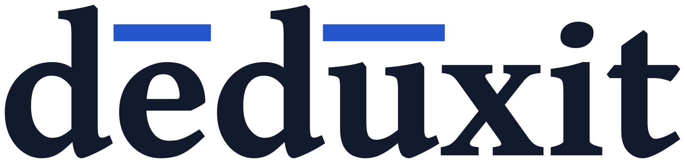

# <picture><source media="(prefers-color-scheme: dark)" srcset="src/logo/wordmark-dark.svg"></picture>

> **dēdūxit** [deːˈduːk.sɪt] *Latin, verb*: "it has derived", the perfect of *dēdūcō*, to lead down, derive.

A web page for proving sequents of linear logic, and of ordinary propositional logic, by
clicking: https://deduxit.github.io/. It is the web front end of
[deduxit](https://github.com/deduxit/deduxit). The prover runs in the page, as deduxit's
library compiled to WebAssembly: nothing to install, and nothing you type leaves your
browser.

## Using the page

1. Type a sequent in the field, such as `A * B |- B * A` (`*` is ⊗, `|` is ⅋, `-o` is
   ⊸, `|-` is ⊢), and press Enter.
2. Click a formula of an open goal. The popover lists the rules deduxit allows on it;
   point at a rule, focus it or tap its ⓘ to see its schema and what it does.
3. Pick a rule. A split asks which formulas go to the left premise, and says whether it
   can still close. A refused step says why, at the goal; Other rules shows the
   formula's rules again.
4. Stuck? Hint gives the next step a little at a time. Close goal or Close all lets the
   search finish, within the budget in Settings. When the search finds that a goal an
   earlier step made has no proof, Go back returns to the last goal that still has one.

The mark beside the sequent ("Linear (LL) ▾") chooses the logic: classical or
intuitionistic linear logic, with Mix or affine weakening, or ordinary logic in LK or LJ.
Learn has eleven lessons and a reference; Practice has 407 problems with a proof, filtered
by kind and difficulty; the tour shows the page itself. The empty page offers lesson 1 and
the tour.

## What it does

- Proofs: undo on the goal you work on, redo, and a list of every step to go back to;
  a goal opened in a tab of its own and filled back in; the cut rule; quantifiers, with
  eigenvariables and witnesses; cut elimination on the derivation and on the net.
- Verdicts: proved and checked by deduxit's checker; unprovable, with the reason and,
  where there is one, a checked certificate; or unknown, when the search gave up. Every
  search names the engine that did its work.
- Drawings: the derivation as deduxit draws it, one-sided or two-sided; the proof net
  of a finished MLL or MELL proof, and the essential net in intuitionistic logic; every
  rule label with its hint.
- Exports: SVG, PNG, PDF, LaTeX (ebproof), Typst (curryst), text, the session as JSON,
  a Rocq certificate of the proof, and a Rocq certificate that a refuted goal has no proof.
  The drawings take one of five math fonts.
- Keeping work: the proof in the link; every open proof saved in the browser and
  offered back on the next visit; import of a session or a sequent.
- Access: everything by keyboard (`?` lists the keys); light and dark themes; every
  colour that carries a meaning also has a word, a sign or a shape; on a phone every
  control is at least 44 by 44 pixels.
- Offline: after one visit the page works without a network and can be installed as
  an app. No cookies and no tracking; the privacy page (`/privacy/`) says what GitHub logs
  and what the browser keeps.

Every one of the 452 problems in `src/content/problems/` is decided by deduxit's command,
which a flake check runs over them all; a provable one comes with a proof deduxit accepts.

## Building

Everything comes from the Nix flake (flake-parts, `modules/`):
- `nix develop` (or direnv) opens the dev shell; its `menu` lists the commands;
- `nix build` builds the site into `result/`;
- `nix flake check` runs every check: the site's build, Vitest, `astro check`, Biome,
  Playwright in Chromium, the Content-Security-Policy's hashes, the licences served, the
  formatting, the licence headers, and the problems against deduxit's command.

The site is Astro with one Solid island, in TypeScript with Tailwind. deduxit's
WebAssembly bindings come from deduxit's own flake, a pinned input of this one. The
written content is Markdown under `src/content/`.

## Hosting

GitHub Pages serves the site at https://deduxit.github.io/: every push to `main`
whose checks pass is deployed by the CI workflow. deduxit's API documentation at
https://deduxit.github.io/deduxit/ is deduxit's own Pages site, and the Rocq library's at
https://deduxit.github.io/rocq-deduxit/ is its own; nothing here touches them, the service
worker included. The library's old address, `/rocq-linlog/`, forwards to its new one. The Content-Security-Policy is a `<meta>` element,
since Pages sets no header.

## Licences

The code is licensed under the [EUPL-1.2](LICENSE). The written content (explanations,
tutorials, worked examples and exercises, under `src/content/`) is licensed under
[CC BY 4.0](https://creativecommons.org/licenses/by/4.0/), as the pages that carry it say.
deduxit's mark (`src/logo/`, served at `/logo/` with every image drawn from it) is
licensed under CC BY 4.0 too (`src/logo/LICENSE.txt`); the name deduxit and its mark
identify this project, and may not be used to suggest its endorsement of anything else.
Its word is Gentium ExtraBold outlined, so no font file goes with it.
The fonts are under the SIL Open Font License 1.1: Euler Math, STIX Two Math,
Garamond-Math and Asana Math (from deduxit), Figtree and Space Mono (from Fontsource); New
Computer Modern Math (from deduxit) is under the GUST Font License, which is the LaTeX
Project Public License 1.3c. Each is served beside its licence under `/fonts/`. The site
serves the notices of the npm packages in its bundle (`/licenses/bundle.txt`) and of the
Rust crates in deduxit's module (`/licenses/THIRD-PARTY-NOTICES.txt`).
